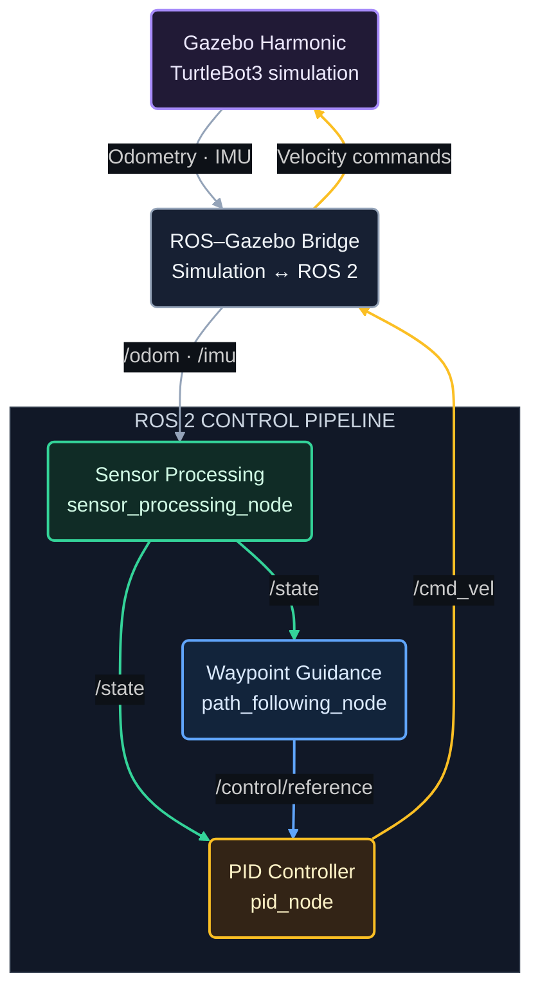

# TurtleBot3 Control and LOS Guidance

**Técnico Solar Boat — Autonomous Systems Recruitment**

A ROS 2 control system for a TurtleBot3 Burger in Gazebo Harmonic, combining forward-velocity and heading PID control, IMU/odometry processing, and autonomous waypoint following using Line-of-Sight (LOS) guidance.

The C++ implementation includes anti-windup, velocity feedforward, heading gain scheduling, and independent algorithm tests. YAML configurations and launch files support manual control and autonumous missions.

## Contents

1. [Packages and architecture](#packages-and-architecture)
2. [Repository layout](#repository-layout)
3. [Control and estimation methods](#control-and-estimation-methods)
4. [Environment and dependencies](#environment-and-dependencies)
5. [Build and quickstart](#build-and-quickstart)
6. [Execution workflows](#execution-workflows)
7. [Configuration reference](#configuration-reference)
8. [Testing](#testing)
9. [Simulation validation](#simulation-validation)
10. [Troubleshooting](#troubleshooting)
11. [Scope and release status](#scope-and-release-status)
12. [References and attribution](#references-and-attribution)

## Packages and architecture

| Package | Function |
| --- | --- |
| `tsb_control` | PID controller, sensor processing, LOS guidance, reusable algorithm headers, YAML parameters, and tests. |
| `tsb_interfaces` | Defines the ControlReference message, which carries a timestamped forward-velocity and heading reference between the path-following and PID nodes. |
| `tsb_simulation` | TurtleBot3 model configured for Gazebo Harmonic, the test world (`control_world.sdf`), ROS–Gazebo bridge configuration, and launch files. |

The following flowchart illustrates the full pipeline implemented for this project.




### `pid_node`

Subscribes to `/control/reference` and `/state`, then publishes forward
and angular velocity commands on `/cmd_vel`.

The node uses two independent instances of the same PID class: one for
forward velocity and one for heading. It supports output limits,
anti-windup, forward-velocity feedforward, and heading gain scheduling.
Missing or stale inputs cause the controller to publish zero velocity.

For the TurtleBot simulation, Gazebo's differential-drive system converts
these velocity commands into wheel motion. A separate allocation node for converting
control outputs into motor-current commands, as described in the porjects documentation, is therefore not implemented
in this version.

### `sensor_processing_node`

Subscribes to `/odom` and `/imu`, validates the measurements, and publishes
the processed robot state on `/state`.

Odometry supplies position and forward velocity. A complementary estimator
combines odometry heading with IMU-derived yaw rate to estimate the robot's
heading.

### `path_following_node`

Subscribes to `/state` and publishes desired forward velocity and heading
on `/control/reference`.

The node follows an ordered sequence of waypoints using LOS guidance.
It advances to the next waypoint when the robot enters the current
waypoint's acceptance radius. When the robot enters the final waypoint's
acceptance radius, the node requests zero forward velocity.

### Communication topics


The table below shows the information carried by each topic and the
components that send and read it.

| Topic | Information carried | Sent by | Read by |
| --- | --- | --- | --- |
| `/odom` | Simulated odometry: position, orientation, and velocity | Gazebo bridge | Sensor processing node |
| `/imu` | Simulated IMU measurements | Gazebo bridge | Sensor processing node |
| `/state` | Processed robot state | Sensor processing node | PID and path-following nodes |
| `/control/reference` | Desired forward velocity and heading | Path-following node or manual publisher | PID node |
| `/cmd_vel` | Commanded forward and angular velocity | PID node | Gazebo bridge |
| `/clock` | Simulation time | Gazebo bridge | ROS nodes configured to use simulation time |

The bridge transfers sensor messages from Gazebo into ROS and velocity
commands from ROS into Gazebo. It also provides `/scan`, containing lidar
measurements; this topic is available for inspection but is not used by
the current control pipeline. A future implementation using the `/scan` topic could be obstacle avoidance, for example.

The message types are:

- `/odom` and `/state`: `nav_msgs/msg/Odometry`
- `/imu`: `sensor_msgs/msg/Imu`
- `/control/reference`: `tsb_interfaces/msg/ControlReference`
- `/cmd_vel`: `geometry_msgs/msg/Twist`
- `/clock`: `rosgraph_msgs/msg/Clock`
- `/scan`: `sensor_msgs/msg/LaserScan`

### Reference message

`ControlReference` contains:

```text
std_msgs/Header header
float64 surge_velocity
float64 heading
```

| Field | Meaning |
| --- | --- |
| `header.stamp` | Reference generation time on the ROS clock. |
| `header.frame_id` | Heading reference frame; currently `odom`. |
| `surge_velocity` | Desired body-forward velocity in m/s. |
| `heading` | Desired heading in radians relative to the reference frame. |

### Frames and units

Positions, waypoints, and heading references are expressed in the `odom`
coordinate frame. Forward velocity is measured along the robot's x-axis,
represented by `base_footprint`.

Distances use metres, velocities use m/s, and angles use radians.
Heading zero points along the positive x-axis of `odom`; positive heading
rotation is counterclockwise when viewed from above.

Velocity commands use `Twist.linear.x` for forward speed and
`Twist.angular.z` for turning rate in rad/s. Other components are zero.

The sensor-processing node expects the IMU frame
`turtlebot3_burger/imu_link/tb3_imu`, with axes aligned to the robot.

All nodes and reference publishers use simulation time so message
timestamps can be compared consistently.

## Repository layout

```text
tsb_ws/
├── README.md
├── .gitignore
└── src/
    ├── tsb_control/
    │   ├── config/            # PID, sensor, and route settings
    │   ├── include/tsb_control/
    │   │   ├── pid.hpp
    │   │   ├── heading_estimator.hpp
    │   │   ├── los_guidance.hpp
    │   │   └── gain_schedule.hpp
    │   ├── src/               # Three C++ ROS nodes
    │   ├── test/              # Four standalone algorithm tests
    │   ├── CMakeLists.txt
    │   └── package.xml
    ├── tsb_interfaces/
    │   ├── msg/ControlReference.msg
    │   ├── CMakeLists.txt
    │   └── package.xml
    └── tsb_simulation/
        ├── config/bridge.yaml
        ├── launch/
        ├── models/
        ├── worlds/control_world.sdf
        ├── CMakeLists.txt
        └── package.xml
```

`build/`, `install/`, and `log/` are generated by colcon. `results/` contains local experiment data. These directories are excluded from the repo.

## Control and estimation methods

The angular wrapping operation used throughout the implementation is:

$$
\mathrm{wrap}(a)=\mathrm{atan2}(\sin a,\cos a).
$$

### Discrete PID and anti-windup

The controller errors are:

$$
e_v=v_d-v,\qquad e_\psi=\mathrm{wrap}(\psi_d-\hat\psi).
$$

For each controller, the proportional, the proposed integral update and the derivative contributions are:

$$
 P_k=K_p e_k, \qquad I_k^*=I_{k-1}+e_k\Delta t,\qquad D_k=K_d\frac{\delta e_k}{\Delta t}.
$$

For surge, $\delta e_k=e_k-e_{k-1}$; for heading, that difference is wrapped. The first sample after construction or reset has zero derivative contribution.

The proposed output is:

$$
c_k^*=c_{\mathrm{ff}}+P_k+K_iI_k^*+D_k.
$$

The controller first calculates the command using the proposed integral value.
The output limits are **−0.20 to +0.20 m/s for surge** and **−1.0 to +1.0 rad/s
for heading**.

If the proposed command is above its upper limit and the integral update
increases it, or below its lower limit and the update decreases it, the
update is rejected and the previous integral value is retained. Otherwise,
the update is accepted.

The final command is calculated using the retained or updated integral
and clamped to the corresponding output limits.

For surge, $c_{\mathrm{ff}}=v_d$ supplies the forward-velocity baseline. For heading, $c_{\mathrm{ff}}=0$. The surge feedforward term is a velocity-command baseline.

### Speed-dependent heading gains

The scheduling variable is $s=|v_d|$. Between the configured speed thresholds:

$$
\alpha=\mathrm{clamp}\left(\frac{s-s_l}{s_h-s_l},0,1\right),\qquad
K(s)=(1-\alpha)K_l+\alpha K_h.
$$

The interpolation is applied independently to proportional, integral, and derivative gains. Outside the thresholds, the nearest endpoint gain set is selected. 

When both old and new integral gains are nonzero, the stored integral is rescaled to preserve its contribution. Setting $K_i$ to zero clears the accumulated integral error. If $K_i$ is later set to a nonzero value, integration starts again from zero. Changes to $K_p$ or $K_d$ can still cause an immediate change in the control command, so gain updates are not guaranteed to produce a smooth transition.

### Complementary heading estimation

Odometry provides the absolute heading reference. With aligned IMU and robot axes, the yaw rate is calculated from roll $\phi$, pitch $\theta$, and body rates $q,r$:

$$
\dot\psi_{\mathrm{imu}}=
\frac{\sin\phi\,q+\cos\phi\,r}{\cos\theta}.
$$

Measurements are rejected when the robot's pitch is too close to ±90°,
where converting IMU angular velocity into heading rate becomes
numerically unstable. The heading estimator initializes from the first accepted odometry heading. After initialization, the estimator predicts and corrects heading:

$$
\psi^-_k=\mathrm{wrap}(\hat\psi_{k-1}+\dot\psi_{\mathrm{imu}}\Delta t),
$$

$$
\alpha_f=e^{-\Delta t/\tau},\qquad
\hat\psi_k=\mathrm{wrap}\left(
\psi^-_k+(1-\alpha_f)\mathrm{wrap}(\psi_{\mathrm{odom},k}-\psi^-_k)
\right).
$$

A larger time constant $\tau$ gives more importance to the gyro prediction. A smaller value gives greater weight to odometry correction. The implementation uses the latest accepted IMU sample during an odometry-driven update.

### LOS guidance and approach speed

For a directed segment from $A$ to $B$, let $\chi$ be the segment heading, $e_\perp$ the signed cross-track error, and $\Delta d$ the lookahead distance. The desired heading is:

$$
\psi_d=\mathrm{wrap}\left(\chi-\mathrm{atan2}(e_\perp,\Delta d)\right).
$$

Positive cross-track error means the robot lies left of the directed segment. The heading correction steers toward the path. If the endpoint is passed without satisfying arrival, guidance directs the robot toward that endpoint.

Forward speed is reduced according to heading alignment and endpoint distance $d$:

$$
v_d=\min(v_{\mathrm{cruise}},k_a d)\,
\max\left(0,\cos\mathrm{wrap}(\psi_d-\hat\psi)\right).
$$

Entering a waypoint's acceptance radius advances the route. At the final waypoint, guidance requests zero speed and captures the current heading as its final heading reference. A closed route repeats the first coordinate at its end and completes one circuit.

### Timing and inactive control

| Condition | PID response |
| --- | --- |
| First timer tick | Establish timing and publish the initial zero command. |
| Reference or state unavailable | Reset controller history and publish zero velocity. |
| Stale message or receipt age | Reset history and publish zero velocity. |
| ROS time unchanged | Skip integration and derivative updates. |
| Backward clock jump or excessive interval | Discard old input flags, reset, and publish zero velocity. |
| Invalid calculated error or non-finite output | Reset and publish zero velocity. |

## Environment and dependencies

### Dependency setup

This project was developed and tested on Ubuntu 22.04 under WSL2, using ROS 2 Humble and Gazebo Harmonic (8.11.0), with `ros_gz` built from source for Harmonic compatibility.

The tested workspace arrangement is:

```text
/opt/ros/humble → ~/gazebo_ws → ~/tsb_ws
                 shared bridge   this repository
```

`gazebo_ws` is an external dependency workspace containing `ros_gz` and it is not included in this repository. This workspace was created so that other workspaces such as `turtlebot3_ws` that use ROS2 Humble and Gazebo can all use a shared Gazebo integration workspace.

The following commands assume the shared integration workspace has already been built. Please check it before building the project!!

Load ROS 2 and the shared workspace containing the Harmonic-compatible
ROS–Gazebo integration:

```bash
source /opt/ros/humble/setup.bash
source ~/gazebo_ws/install/setup.bash
```

Note that while running the project specific commands each terminal should be sourced after every build.

Check the Gazebo version and confirm that ROS can locate the integration packages:

```bash
gz sim --versions
ros2 pkg prefix ros_gz_sim
ros2 pkg prefix ros_gz_bridge
```

In the development environment, Gazebo reports version `8.11.0`, and both ROS
packages resolve to paths under `~/gazebo_ws/install`. Adapt the workspace
path if your integration is installed elsewhere!!

For initial setup or after adding dependencies, use an installed and initialized
`rosdep` to install missing dependencies declared in the project `package.xml` files.

## Build and quickstart

### Build

Build from a shell that has the dependency underlay sourced, but not this project's existing installation. This avoids treating the workspace as its own underlay.

The following starts a clean shell for compilation only:

```bash
env -i HOME="$HOME" USER="$USER" TERM="$TERM" LANG=C.UTF-8 PATH=/usr/local/bin:/usr/bin:/bin /bin/bash --noprofile --norc
```

Inside that shell:

```bash
source /opt/ros/humble/setup.bash
source ~/gazebo_ws/install/setup.bash
cd ~/tsb_ws
colcon build --packages-up-to tsb_simulation --symlink-install --cmake-args -DBUILD_TESTING=ON -DCMAKE_EXPORT_COMPILE_COMMANDS=ON
```

`--packages-up-to tsb_simulation` includes the project's dependent packages. To rebuild only control and its workspace dependencies, replace the target with `tsb_control`.

### Run the complete mission

In a normal terminal after a successful build:

```bash
source ~/tsb_ws/install/setup.bash
ros2 launch tsb_simulation mission.launch.py
```

This starts Gazebo, the bridge, sensor processing, PID control, and waypoint guidance. The mission begins when valid inputs are available.

## Execution workflows

Source `~/tsb_ws/install/setup.bash` in every new runtime terminal.
In this implementation, I provide 3 independent launch files. `simulation.launch.py` and `control.launch.py` were mainly used to test the Gazebo and Simulation/Nodes launches seperatly. `mission.launch.py` launches the complete pipeline.

| Launch file | Starts |
| --- | --- |
| `simulation.launch.py` | Gazebo and the bridge |
| `control.launch.py` | Simulation, bridge, sensor processing, and PID |
| `mission.launch.py` | The complete pipeline, including path following |

### Simulation and sensor inspection

Terminal 1:

```bash
ros2 launch tsb_simulation simulation.launch.py
```

Terminal 2:

```bash
ros2 topic echo /clock --once
ros2 topic echo /odom --once
ros2 topic echo /imu --once
ros2 topic echo /scan --once
```

These commands wait for a message and are used to check the health of each topic.

### Manual speed and heading references

Terminal 1:

```bash
ros2 launch tsb_simulation control.launch.py
```

Terminal 2:

```bash
ros2 topic pub --rate 10 --use-sim-time /control/reference tsb_interfaces/msg/ControlReference '{header: {stamp: now, frame_id: odom}, surge_velocity: 0.1, heading: 0.5}'
```

This requests 0.1 m/s and a heading of 0.5 rad. Stop the publisher with Ctrl+C to exercise the reference timeout. Do not run it alongside the path follower because they both publish to the same reference topic so the it would choke!

### Choose a waypoint route

Start `control.launch.py` in one terminal, then start the path follower separately:

```bash
ros2 run tsb_control path_following_node --ros-args --params-file ~/tsb_ws/install/tsb_control/share/tsb_control/config/path_square.yaml -p use_sim_time:=true
```

| Route file | Waypoint sequence |
| --- | --- |
| `path_following.yaml` | `(0, 0) → (2, 0) → (2, 1.5)` |
| `path_square.yaml` | `(0, 0) → (2, 0) → (2, 1.5) → (0, 1.5) → (0, 0)` |

The current mission launch loads `path_following.yaml`. The separate-node workflow supports selecting another route file. Note that since the project doesnt require PID tuning, the `path_square.yaml` mission does not execute perfectly. The mission is considered finished when the turtlebot is within the 0.15 accepttance radius from the final waypoint.

### Start individual processing and control nodes

With only `simulation.launch.py` running, use separate terminals for:

```bash
ros2 run tsb_control sensor_processing_node --ros-args --params-file ~/tsb_ws/install/tsb_control/share/tsb_control/config/sensors.yaml -p use_sim_time:=true
```

```bash
ros2 run tsb_control pid_node --ros-args --params-file ~/tsb_ws/install/tsb_control/share/tsb_control/config/pid.yaml -p use_sim_time:=true
```

Then supply references using a manual publisher or the path follower.

For inspection without sending this PID's output to Gazebo, append `-r cmd_vel:=/control/command_test` to its command. Likewise, `-r control/reference:=/control/reference_test` on the path follower redirects its references away from the normal PID input.

## Configuration reference

Source YAML files under `src/tsb_control/config/`. Rebuild to install new configuration files, and restart the affected nodes to load changes.

| File | Configuration |
| --- | --- |
| `pid.yaml` | Surge/heading gains, output limits, heading gain schedule, control frequency, input timeout, and maximum accepted control interval. |
| `sensors.yaml` | Heading filter time constant, input timing limits, and expected frames. |
| `path_following.yaml` | Corner route and LOS lookahead. |
| `path_square.yaml` | Closed rectangular route and LOS lookahead. |
| `src/tsb_simulation/config/bridge.yaml` | Gazebo/ROS topic names, types, and bridge directions. |

### PID parameters

| Parameter | Meaning or constraint |
| --- | --- |
| `surge.kp`, `surge.ki`, `surge.kd` | Finite forward-velocity feedback gains. |
| `surge.output_min`, `surge.output_max` | Finite velocity-command limits in m/s |
| `heading.kp`, `heading.ki`, `heading.kd` | Finite low-speed heading gains. |
| `heading.output_min`, `heading.output_max` | Finite angular-command limits in rad/s |
| `heading.schedule.low_speed` | Lower absolute reference-speed threshold, ≥ 0 m/s. |
| `heading.schedule.high_speed` | Upper threshold, greater than the lower threshold. |
| `heading.schedule.high.kp/ki/kd` | High-speed heading gains. |
| `control.rate_hz` | Timer frequency, 1–1000 Hz. |
| `control.input_timeout` | Positive maximum accepted input age, in seconds. |
| `control.max_dt` | Maximum accepted control interval, in seconds; greater than the nominal period. |

The baseline configuration used during development is shown below:

```yaml
pid_node:
  ros__parameters:
    surge:
      kp: 0.5
      ki: 0.0
      kd: 0.0
      output_min: -0.20
      output_max: 0.20
    heading:
      kp: 1.0
      ki: 0.0
      kd: 0.0
      output_min: -1.0
      output_max: 1.0
      schedule:
        low_speed: 0.0
        high_speed: 0.20
        high:
          kp: 1.0
          ki: 0.0
          kd: 0.0
    control:
      rate_hz: 20.0
      input_timeout: 1.0
      max_dt: 0.2
```

### Sensor parameters

| Parameter | Development setting | Purpose |
| --- | --- | --- |
| `heading.time_constant` | 0.5 s | Complementary-filter prediction/correction balance. |
| `timing.input_timeout` | 1.0 s | Sensor timestamp freshness limit. |
| `timing.future_tolerance` | 0.1 s | Allowed future timestamp offset in sensor processing. |
| `timing.max_sample_separation` | 0.1 s | Maximum separation between accepted sensor sample stamps. |
| `timing.max_dt` | 0.2 s | Maximum heading-estimator update interval. |
| `frames.odom` | `odom` | Expected odometry reference frame. |
| `frames.base` | `base_footprint` | Expected odometry child frame. |
| `frames.imu` | `turtlebot3_burger/imu_link/tb3_imu` | Expected IMU frame. |

Sensor acceptance does not override the PID's own timestamp checks. Frame parameters validate an expected convention; they do not transform arbitrary sensor extrinsics automatically.

### Route example

```yaml
path_following_node:
  ros__parameters:
    guidance:
      lookahead: 0.5
    waypoints:
      x: [0.0, 2.0, 2.0, 0.0, 0.0]
      y: [0.0, 0.0, 1.5, 1.5, 0.0]
```

Coordinates pair by index and are expressed in metres in `odom`. This route completes one loop and stops.

In the validated implementation, the waypoint acceptance radius is 0.15 m and applies to intermediate and final waypoints. A position inside that radius counts as arrival; exact convergence to the waypoint is not required.

Inspect the complete configuration of running nodes with:

```bash
ros2 param dump /pid_node
ros2 param dump /sensor_processing_node
ros2 param dump /path_following_node
```

### Heading gain scheduling

`heading.kp`, `heading.ki`, and `heading.kd` specify the low-speed gains. `heading.schedule.high` supplies the high-speed gains. Thresholds are `heading.schedule.low_speed` and `heading.schedule.high_speed`, in m/s.

Between the thresholds, each gain is interpolated linearly using absolute desired speed. Outside them, the nearest endpoint gains are used. Gain updates preserve the integral contribution when both old and new integral gains are nonzero; disabling integral action clears its stored contribution. Changes to proportional or derivative gains can still change the output.

A tested example used speed thresholds 0.0 and 0.20 m/s, low-speed `kp = 1.0`, and high-speed `kp = 0.6`. At a reference of 0.10 m/s, the selected `kp` was 0.8.

## Testing

### Algorithm tests

After building with `BUILD_TESTING=ON`:

```bash
ctest --test-dir ~/tsb_ws/build/tsb_control --output-on-failure -R '^(pid_test|heading_estimator_test|los_guidance_test|gain_schedule_test)$'
```

This command runs all test executables listed below.

| Test executable | Coverage |
| --- | --- |
| `pid_test` | PID terms, first-sample handling, invalid time input, saturation, anti-windup including derivative/feedforward effects, angular differences, reset, and gain updates. |
| `heading_estimator_test` | Prediction/correction, angular wraparound, reset, and invalid inputs. |
| `los_guidance_test` | Path geometry, cross-track correction direction, lookahead behaviour, and invalid geometry. |
| `gain_schedule_test` | Endpoints, interpolation, reverse-speed symmetry, and invalid inputs. |

All four algorithm tests passed in the development environment.

#### Run an individual test

Each command below runs one test and displays its diagnostic output if it fails.

```bash
# PID controller
ctest --test-dir ~/tsb_ws/build/tsb_control \
  --output-on-failure -R '^pid_test$'

# Heading estimator
ctest --test-dir ~/tsb_ws/build/tsb_control \
  --output-on-failure -R '^heading_estimator_test$'

# LOS guidance
ctest --test-dir ~/tsb_ws/build/tsb_control \
  --output-on-failure -R '^los_guidance_test$'

# Gain scheduling
ctest --test-dir ~/tsb_ws/build/tsb_control \
  --output-on-failure -R '^gain_schedule_test$'
```

The commands share the same structure: only the test name changes.
## Simulation validation

### Validation matrix

Start route experiments from a fresh simulation when comparing trajectories or final positions.

| Check | Procedure | Expected observation |
| --- | --- | --- |
| Communication | Launch a mission and inspect the graph. | State, reference, and command topics are active. |
| Heading control | Use control mode with zero forward speed and a nonzero heading reference. | Rotation toward the requested heading. |
| Forward control | Publish a finite positive forward reference and heading. | Forward motion with heading correction. |
| Corner route | Run `path_following.yaml`. | Waypoint transition, final-arrival message, and zero final forward reference. |
| Closed route | Run `path_square.yaml`. | Progress through four target indices and return near the start. |
| Gain scheduling | Use heading `kp` endpoints 1.0/0.6 and speed thresholds 0.0/0.20 m/s. | Active gain follows the interpolation law. |
| Reference loss | Stop only the standalone path follower during motion. | PID detects stale input and commands zero velocity. |
| Recovery | Restart the path follower while control mode remains running. | Fresh references restore control; guidance starts a new waypoint sequence. |

This table defines procedures and expected outcomes.

### Inspect the running graph

```bash
ros2 node list
ros2 node info /pid_node
ros2 topic info /state
ros2 topic echo /control/reference --once
ros2 topic echo /cmd_vel --once
ros2 topic echo /state --once --field pose.pose.position
```

A complete mission normally includes `/simulation_bridge`, `/sensor_processing_node`, `/pid_node`, and `/path_following_node`.

### Reference-loss and recovery test

1. Start a fresh `control.launch.py` instance.
2. Start the path follower separately with a route YAML.
3. While the robot moves, stop only the path follower using Ctrl+C.
4. With the configured 1.0 s input timeout, check that the PID reports stale input and publishes zero velocity after approximately that interval.
5. Inspect `/cmd_vel` to confirm zero linear and angular commands.
6. Restart the path follower and confirm fresh references restore control.

Stopping on lost references and subsequent mission completion after restarting the path follower were observed. This tests loss of the reference producer while the PID remains alive.

### Recorded observations

| Scenario | Observation |
| --- | --- |
| Corner route ending at `(2.0, 1.5)` | Final measured position approximately `(1.99832, 1.35351)`; target distance approximately 0.1465 m. |
| Closed route ending at `(0.0, 0.0)` | Final measured position approximately `(0.00120, 0.14547)`; target distance approximately 0.1455 m. |
| Heading gain scheduling | Logged reference/gain pairs included 0.100 m/s → 0.800, 0.086 m/s → 0.828, and 0.066 m/s → 0.868; the corner mission completed. |
| Reference publisher stopped | PID requested zero velocity; restarting the path follower allowed mission to finnish. |

For a final target $(x_g,y_g)$, endpoint distance is:

$$
d_{\mathrm{final}}=\sqrt{(x-x_g)^2+(y-y_g)^2}.
$$

Both recorded distances are within the configured 0.15 m acceptance radius.

### Record a run

Stop any previous simulation before starting a new recording. In a recording terminal:

```bash
source ~/tsb_ws/install/setup.bash
mkdir -p ~/tsb_ws/results
ros2 bag record --use-sim-time -o ~/tsb_ws/results/corner_baseline_01 /clock /odom /imu /state /control/reference /cmd_vel
```

Start the mission in a different terminal. After it completes, allow a short settling interval, then stop the recorder with Ctrl+C and wait for its prompt to return.

```bash
ros2 bag info ~/tsb_ws/results/corner_baseline_01
```

Use a new directory name for each run. Save the configuration used by that experiment before changing it for another run:

```bash
mkdir -p ~/tsb_ws/results/corner_baseline_01_config
cp ~/tsb_ws/src/tsb_control/config/pid.yaml ~/tsb_ws/results/corner_baseline_01_config/
cp ~/tsb_ws/src/tsb_control/config/sensors.yaml ~/tsb_ws/results/corner_baseline_01_config/
cp ~/tsb_ws/src/tsb_control/config/path_following.yaml ~/tsb_ws/results/corner_baseline_01_config/
```

For the closed route, save `path_square.yaml` instead.

## References

- [ROS 2 Humble documentation](https://docs.ros.org/en/humble/)
- [Gazebo Harmonic — ROS integration](https://gazebosim.org/docs/harmonic/ros_installation/)
- [ros_gz_bridge — Humble](https://github.com/gazebosim/ros_gz/tree/humble/ros_gz_bridge)
- [ROBOTIS TurtleBot3 — Original model and mesh assets](https://github.com/ROBOTIS-GIT/turtlebot3_simulations/tree/humble)
- [PID control and anti-windup](https://control.ros.org/rolling/doc/api/classcontrol__toolbox_1_1Pid.html)
- [Fossen and Pettersen (2014) — LOS guidance](https://www.fossen.biz/publications/2014%20Fossen%20and%20Pettersen%20Automatica.pdf)
- [Complementary filtering](https://ahrs.readthedocs.io/en/stable/filters/complementary.html)
- [CMake — CTest](https://cmake.org/cmake/help/v3.22/manual/ctest.1.html)